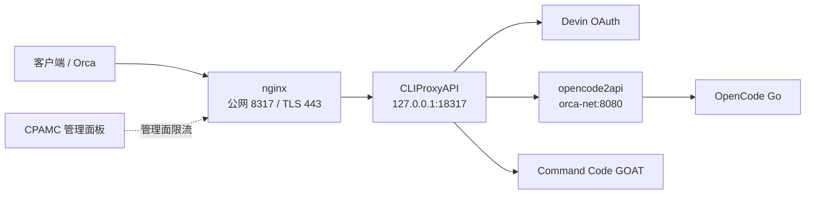

# orca-ai-pool

> **说明文档**：面向使用者和部署者。技术实现见 [`docs/TECHNICAL.md`](docs/TECHNICAL.md)，
> 完整部署步骤见 [`DEPLOY.md`](DEPLOY.md)，容量规划见 [`docs/capacity-planning.md`](docs/capacity-planning.md)。

orca-ai-pool 是一个多上游 AI 号池网关。它用 **CPA (CLIProxyAPI)** 做统一入口，
把 OpenAI 兼容请求按模型路由到 Devin、OpenCode Go 和 Command Code GOAT，
再用加权轮询、会话亲和和冷却策略保护上游额度与 prompt cache。

## 能力概览

- **单一入口**：客户端只需要一个 OpenAI 兼容地址和主 key。
- **三路上游**：Devin OAuth、OpenCode Go、Command Code GOAT。
- **缓存优先**：同一会话尽量粘同一凭据，避免前缀缓存被轮询打散。
- **配额可见**：Devin 通过管理接口读配额，OpenCode Go 通过自研插件展示逐 key 余量。
- **可选破甲别名**：`<模型名>-jailbreak` 在进入上游前注入固定提示词，执行模型不变。
- **可选 Devin 敏感词混淆**：按 `accounts.yaml` 开关对 Devin 请求做零宽字符处理。
- **可重复部署**：`.env` + `accounts.yaml` + `poolctl render` 生成全部运行配置。

## 系统架构



### 三路上游

| 上游 | 凭据 | 主要作用 |
|---|---|---|
| Devin | OAuth session token | 免费/Pro 模型主力，`swe-2` 系列与 `gemini-4-argon` |
| OpenCode Go | API key + 静态出口 | DeepSeek 等高频执行模型容量池 |
| Command Code GOAT | API key | 直连兜底，降低单一上游故障影响 |

### 对外模型

客户端直接使用模型 ID，`GET /v1/models` 就是实际路由表：

| 模型 | 路由 |
|---|---|
| `devin/swe-2` | Devin OAuth |
| `devin/swe-2-lightning` | Devin OAuth |
| `devin/gemini-4-argon` | Devin OAuth |
| `deepseek-v4.1-flash` | OpenCode Go / GOAT 聚合 |
| `deepseek-v4.1-flash-jailbreak` | 同 `deepseek-v4.1-flash`，注入破甲提示词 |

破甲别名只在 `prompts/manifest.yaml` 配置了对应 profile 时出现。模型 ID 进入上游前
会还原成基座模型，破甲插件只修改请求内容。

## 快速开始

完整步骤、账号录入和验证命令见 [`DEPLOY.md`](DEPLOY.md)。最短路径如下：

```bash
# 1. 系统依赖
sudo apt-get update
sudo apt-get install -y nginx python3-yaml golang-go build-essential openssl

# 2. 配置
cp .env.example .env
cp accounts.example.yaml accounts.yaml
chmod 600 .env accounts.yaml
# 编辑 .env 和 accounts.yaml，填入真实密钥与账号

# 3. 渲染配置
python3 scripts/poolctl.py render

# 4. 预检 Go key
python3 scripts/poolctl.py check-opencode

# 5. 构建配额插件（可选，但推荐）
(cd plugin/opencode-go-quota && make install)

# 6. 启动网关
docker compose up -d

# 7. 安装 nginx 入口。首次会生成自签证书
sudo bash scripts/install-nginx.sh
```

部署后至少验证一次模型列表和一条真实请求：

```bash
export CPA_KEY=$(grep '^MASTER_API_KEY=' .env | cut -d= -f2)
export HOST=$(grep '^GATEWAY_HOST=' .env | cut -d= -f2)

curl -s "http://$HOST:8317/v1/models" \
  -H "Authorization: Bearer $CPA_KEY" | python3 -m json.tool | head -40

curl -s "http://$HOST:8317/v1/chat/completions" \
  -H "Authorization: Bearer $CPA_KEY" \
  -H 'Content-Type: application/json' \
  -d '{"model":"devin/swe-2","messages":[{"role":"user","content":"ping"}],"max_tokens":8}'
```

返回 `choices` 即说明入口、CPA 和至少一条上游链路工作正常。

## 使用方式

| 操作 | 命令 |
|---|---|
| 渲染全部配置 | `python3 scripts/poolctl.py render` |
| 预检 Go key | `python3 scripts/poolctl.py check-opencode` |
| 查看实时配额 | `python3 scripts/poolctl.py quota` |
| 切换 Devin 模式 | `python3 scripts/poolctl.py switch-mode max-hybrid` |
| 轮换密钥 | `python3 scripts/poolctl.py rotate-secret` |
| 导出客户端配置 | `python3 scripts/poolctl.py export-client` |
| 同步破甲提示词 | `python3 scripts/poolctl.py sync-jailbreaks` |

`render` 是唯一配置生成入口。CPA 普通配置会热载；C ABI 插件配置只在进程启动时读取，
改完插件配置后需要 `docker compose restart cliproxyapi`。

## 运行边界

### 端口

| 端口 | 暴露范围 | 用途 |
|---|---|---|
| `8317` | 公网 | nginx 入口，客户端访问 |
| `443` | 公网 | nginx TLS 入口 |
| `18317` | `127.0.0.1` | CPA 回环端口，排障用 |
| `18081` | `127.0.0.1` | opencode2api WebUI，SSH 隧道访问 |
| `8080` | 仅 `orca-net` | CPA 到 opencode2api 的内部 API |

防火墙只需要放行 `8317` 和 `443`。`8080`、`18081`、`18317` 不对公网开放。
CPAMC 管理面板地址为 `http://<服务器>:8317/management.html`，密码是 `CPA_ADMIN_SECRET`。

### 密钥

- `.env`、`accounts.yaml`、`cliproxy/auths/*.json` 必须保持私有权限。
- `poolctl render` 默认把生成产物写成 `0600`，并将 `auths/` 目录收紧到 `0700`。
- 管理面板与主 API 使用不同密钥；生产环境保持 `DISABLE_AUTH=false`。
- 轮换 `OC2API_SERVER_KEY` 后，需要同时重启 `cliproxyapi` 和 `opencode2api`。

### OpenCode Go 风控

4 到 5 个号可以使用 `direct`；扩到 6 个以上时，应配置 2 到 3 个静态 SOCKS5/HTTP 出口，
避免多个 key 共用同一公网 IP。代理 URL 不要带 `#pool`，否则 IP 会漂移并破坏连接复用。

### 客户端建议

本地 Devin 客户端建议关闭 subagents、使用 `reasoningEffort: high` 和 `fastMode: false`，
减少免费池请求扇出。模板见 [`templates/local-devin-config.json`](templates/local-devin-config.json)。

## 文档地图

| 文档 | 内容 |
|---|---|
| [`docs/TECHNICAL.md`](docs/TECHNICAL.md) | 组件契约、配置生成、路由、缓存、插件、安全、CLI、故障排查 |
| [`DEPLOY.md`](DEPLOY.md) | 新加坡服务器首次部署与日常运维 |
| [`docs/capacity-planning.md`](docs/capacity-planning.md) | 号数、额度、缓存命中率与成本模型 |
| [`templates/cliproxy.config.v8.yaml.tmpl`](templates/cliproxy.config.v8.yaml.tmpl) | CPA v8 手工兜底配置 |
| [`templates/opencode2api.config.json.tmpl`](templates/opencode2api.config.json.tmpl) | opencode2api 配置参考 |

## 本地验证

```bash
python3 -m pip install -r requirements.txt
python3 -m unittest discover -s tests -v
(cd plugin/jailbreak-inject && make test)
(cd plugin/opencode-go-quota && make test)
docker compose config --quiet
```

如果系统 Python 受 PEP 668 管理，可用：

```bash
uv run --with pyyaml python3 -m unittest discover -s tests -v
```

## 目录结构

```text
orca-ai-pool/
├── README.md                  # 本说明文档
├── DEPLOY.md                  # 部署与运维 runbook
├── docker-compose.yml         # CPA + opencode2api + 网络
├── accounts.example.yaml      # 号池清单模板
├── .env.example               # 部署参数模板
├── .github/workflows/ci.yml   # 测试、构建与 Compose 校验
├── scripts/
│   ├── poolctl.py             # 配置生成与运维 CLI
│   └── install-nginx.sh       # nginx 配置安装与 TLS 初始化
├── plugin/
│   ├── jailbreak-inject/      # 破甲提示词注入插件
│   └── opencode-go-quota/     # OpenCode Go 配额插件
├── prompts/                   # 破甲清单、overlay、上游提示词
├── templates/                 # 配置参考模板
├── docs/
│   ├── TECHNICAL.md           # 技术文档
│   └── capacity-planning.md   # 容量规划
└── tests/                     # poolctl 回归测试
```

`cliproxy/`、`opencode2api/config.json`、`nginx/`、`export/` 均由工具生成，通常不提交。
