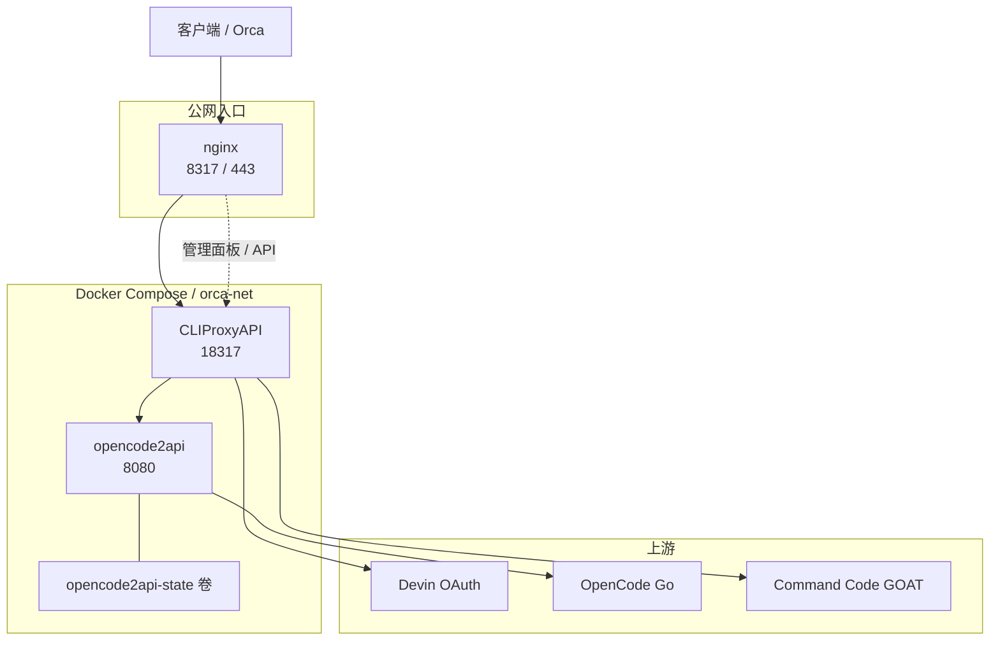
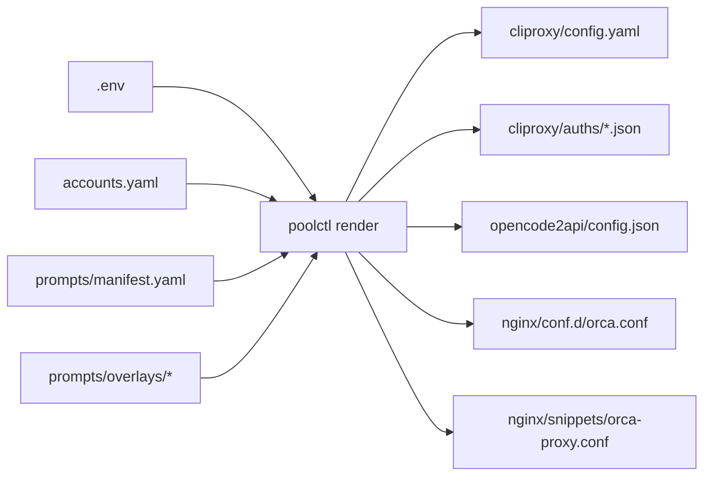
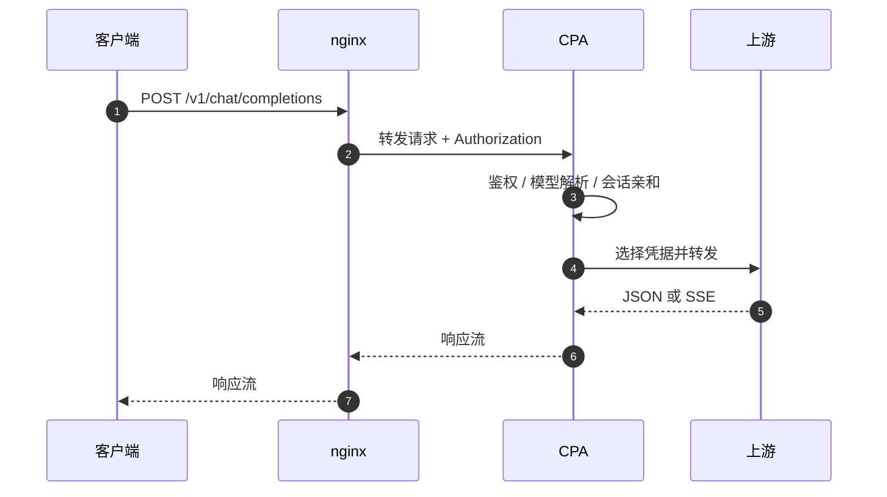
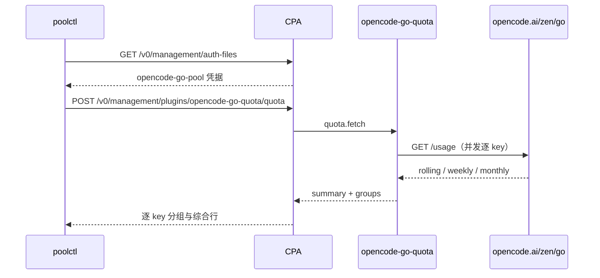
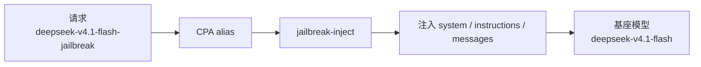
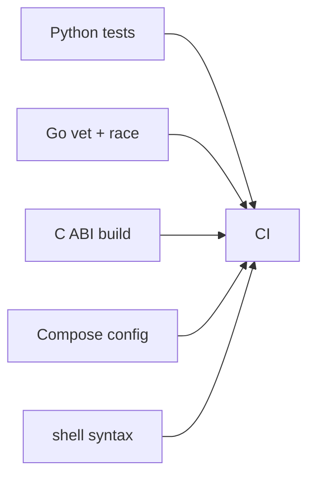

# orca-ai-pool 技术文档

> 面向维护者、插件开发者和排障人员。使用说明见 [`../README.md`](../README.md)，
> 部署步骤见 [`../DEPLOY.md`](../DEPLOY.md)，容量模型见
> [`capacity-planning.md`](capacity-planning.md)。

## 1. 设计目标与边界

orca-ai-pool 只负责三件事：

1. 把统一格式的请求路由到多个上游。
2. 尽量保持同一会话的前缀缓存命中。
3. 把上游额度、凭据和故障状态变成可观测数据。

它不负责生成账号、绕过上游风控或伪造计费。提示词、账号和代理的使用边界由部署者自行承担。

## 2. 组件拓扑



### 组件职责

| 组件 | 职责 | 数据 |
|---|---|---|
| nginx | 公网入口、TLS、管理面限流、`/v1/models` 短缓存 | `nginx/conf.d/orca.conf`、`nginx/snippets/orca-proxy.conf` |
| CPA | 鉴权、模型路由、凭据选择、冷却、重试、usage 统计 | `cliproxy/config.yaml`、`cliproxy/auths/*.json` |
| opencode2api | OpenAI 协议到 OpenCode Go 的桥接、proxy 轮换、连接复用 | `opencode2api/config.json` 与 state 卷 |
| `opencode-go-quota` | AuthProvider + QuotaProvider，展示逐 key 余量 | CPA 插件配置与 `/v0/management/plugins/.../quota` |
| `jailbreak-inject` | 按 `RequestedModel` 选择 prompt profile，修改请求体 | `prompts/manifest.yaml` 与插件配置 |
| `poolctl` | 生成配置、预检、配额查询、密钥轮换、客户端导出 | `.env`、`accounts.yaml`、模板 |

## 3. 端口与网络边界

| 端口 | 绑定 | 是否公网 | 说明 |
|---|---|---|---|
| `8317` | nginx | 是 | 客户端主入口 |
| `443` | nginx | 是 | TLS 入口 |
| `18317` | `127.0.0.1` | 否 | CPA 回环端口，排障时绕过 nginx |
| `18081` | `127.0.0.1` | 否 | opencode2api WebUI，仅 SSH 隧道 |
| `8080` | `orca-net` | 否 | CPA 到 opencode2api 的内部 API |

nginx 是唯一公网监听者。容器只绑定回环或内部网络，避免管理面和内部 API 直接暴露。

## 4. 配置源与 render 流程

`.env` 和 `accounts.yaml` 是事实源。`poolctl render` 不读取运行中的容器，而是重新生成文件：



### 生成物

| 文件 | 内容 | 权限 |
|---|---|---|
| `cliproxy/config.yaml` | CPA v8 配置，含主 key、管理密钥、路由和插件配置 | `0600` |
| `cliproxy/auths/<id>.json` | Devin 凭据 | `0600` |
| `cliproxy/auths/opencode-go-pool.json` | 配额插件池凭据 | `0600` |
| `opencode2api/config.json` | opencode2api 种子配置，含 Go key 与 WebUI 密码 | `0600` |
| `nginx/conf.d/orca.conf` | 公网入口、管理面限流、模型缓存 | `0644` |
| `nginx/snippets/orca-proxy.conf` | 公共代理头、SSE、超时 | `0644` |

`cliproxy/auths/` 目录权限为 `0700`。写入使用临时文件加 `os.replace`，并在写入前设置权限。

### 校验与清理

`render` 会拒绝以下输入：

- 缺少必要环境变量或账号字段。
- 非法端口、非法权重、未知 Devin plan。
- 破甲 profile 缺文件、路径逃出 `prompts/`、未知注入模式。
- 破甲通道开启但 `.so` 不存在。

它还会清理当前账号清单之外的 Devin 凭据，并按 `type=devin` 识别自定义文件名，避免删号后旧凭据继续生效。

### opencode2api 的特殊行为

opencode2api 只在 state 卷为空时导入 `CONFIG_SEED_PATH`。因此修改种子文件后必须：

1. `poolctl render`
2. `docker compose cp opencode2api/config.json opencode2api:/run/config/opencode2api.json`
3. 调 WebUI `/api/config/reload`

`poolctl render` 在容器运行时自动完成上述步骤。直接 `docker compose restart` 不会重新导入新种子。

### CPA 插件重载

CPA 的普通 YAML 配置通过 fsnotify 热载；C ABI 插件的 `plugins.configs` 只在进程启动时应用。
`poolctl render` 会比较 `.poolctl-plugin-state.json` 中的插件配置哈希和容器启动时间，
发现“配置已改但进程未重载”时输出重启提示。

## 5. 请求生命周期



### 路由策略

- `weighted-round-robin`：按凭据权重分配请求。
- `session-affinity: true`：同一会话粘同一凭据，TTL 默认 2 小时。
- `session-affinity-subagents: true`：子会话继承父会话绑定，避免子 agent 重新换号。
- `session-affinity-rebind-on: quota`：只有额度耗尽才改绑；瞬时错误不主动打散缓存。
- `request-retry: 3`：请求级重试，配合 CPA 侧的冷却和上游错误处理。

`oauth.request-scoped-errors` 把 Devin 的 `Reached free model rate limit` 和
`resource_exhausted` 转成“继续 + 冷却”，避免单号限流直接导致整池失败。

### 模型别名

OpenAI 兼容上游的模型条目带 `name`、`alias`、`max-context-length` 和 `thinking` 元数据。
GOAT 的 `name` 是上游 ID `deepseek/deepseek-v4.1-flash`，对客户端统一暴露
`deepseek-v4.1-flash`。Devin 通过 `oauth.settings.devin` 暴露上下文元数据。

## 6. 缓存策略

上游按请求前缀命中缓存。缓存命中率下降时，同样的请求量会消耗更多额度，因此缓存保护优先于绝对均衡。


客户端侧要求：

1. system prompt、工具定义和文件顺序在会话内保持稳定。
2. `prompt_cache_key` 固定在会话级，不要每次请求随机生成。
3. 不要把时间戳、随机 ID 或临时状态放进缓存前缀。
4. 不要为了短期均衡关闭 `session-affinity`。

`/v1/models` 由 nginx 做 60 秒元数据缓存，并开启在途合并，避免冷启动惊群。模型面 `/v1/*`
不做限流，SSE 长流和并行子 agent 不应被入口桶误伤。

## 7. 配额监控

### Devin

`poolctl quota` 对 CPA 管理接口执行：

1. `POST /v0/management/auth-files/refresh`
2. `GET /v0/management/auth-files`
3. 从 `quota.signals` 读取 daily/weekly 余量和重置时间

管理接口不可达时命令返回非零状态，不会在后续代码路径中抛裸异常。

### OpenCode Go



插件行为：

- `quota.fetch` 并发查询所有 key。
- 池凭据返回逐 key groups 和“所有 key 综合”行。
- 单个 key 失败时保留错误 group，不吞掉其他 key 的数据。
- 聚合结果按 `refresh_seconds` 缓存，配置变更时清空缓存。
- 插件配置读取使用锁；`refresh_seconds` 也在快照中读取。

`poolctl quota` 会展开插件返回的 groups，并同时打印按公开额度线性累加的容量估算。

## 8. 破甲注入

破甲模型是客户端可见的别名，不是新上游：



插件根据 `RequestedModel` 去掉后缀，再按 `prompts/manifest.yaml` 的 `models` 匹配 profile。
支持的请求面：

- OpenAI chat：`messages`
- Anthropic：`system` 字符串或 content blocks
- Responses：`instructions`，没有时补 `instructions` 并使用 `input`

注入模式：

| 模式 | 行为 |
|---|---|
| `prepend` | 保留客户端 system，在 system 最前面插入破甲提示词 |
| `append` | 保留客户端 system，追加到 system 末尾 |
| `replace` | 删除 system/developer，只保留破甲提示词 |

同一个 profile 已存在时不会重复插入。未匹配 profile 默认返回 `400 jailbreak_profile_error`；
`unmapped: pass` 可以让请求原样通过。

```yaml
suffix: "-jailbreak"
unmapped: "error"
profiles:
  - name: "deepseek-4-1"
    models: ["deepseek-v4.1-flash", "deepseek/*"]
    file: "upstream/deepseek-4-1.md"
    overlay: "overlays/deepseek-4-1.md"
    mode: "prepend"
```

提示词写在固定 commit 的 `prompts/upstream/` 中，overlay 是本地静态补充。每次修改提示词都会让该模型
的缓存前缀冷启动，`replace` 还会丢掉客户端原有 system 前缀。

## 9. 安全模型

### 密钥分层

| 密钥 | 用途 | 轮换方式 |
|---|---|---|
| `MASTER_API_KEY` | 客户端到 CPA | `poolctl rotate-secret master` |
| `CPA_ADMIN_SECRET` | CPAMC 管理接口 | `poolctl rotate-secret admin` |
| `OC2API_SERVER_KEY` | CPA 到 opencode2api | `poolctl rotate-secret server` |
| `OC2API_WEBUI_PASSWORD` | opencode2api WebUI | `poolctl rotate-secret webui` |

`rotate-secret all` 会同时轮换以上四项。轮换后需要重新 `render`；涉及 server key 时还要重启两个服务。

### 权限

- 输入文件 `.env` 和 `accounts.yaml` 应为 `0600`；`render` 检测到过宽权限会警告。
- 生成文件按 `0600` 写入，`auths/` 目录按 `0700`。
- `export/env.sh` 按 `0600` 写入。
- 备份 `.env.bak.*` 和 `accounts.yaml.bak` 不会进入 Git。

### 管理面

`management.allow-remote: true` 允许通过公网入口访问管理 API。nginx 对管理路径做 per-IP 限流，
插件配额端点使用更严格的桶。生产环境仍应使用强密码，必要时改为 SSH 隧道访问。

`DISABLE_AUTH=true` 只用于测试。生产环境保持 `false`，否则任何能访问 8317 的客户端都可以调用模型。

### OpenCode Go 出口

6 个以上 key 应使用静态代理，并保持 key 与出口的固定对应关系。代理池 URL 和 `#pool` 会造成 IP 漂移，
既影响风控，也会破坏 HTTP/2 keep-alive。

## 10. poolctl CLI

| 子命令 | 作用 | 关键行为 |
|---|---|---|
| `render` | 生成 CPA、opencode2api、nginx 配置和凭据 | 校验输入、设置权限、尽量热载 opencode2api |
| `check-opencode` | 逐 key 做最小请求 | 200 可用，403 区域设置，429 冷却 |
| `quota` | 查询 Devin 与 Go 配额 | 管理接口失败返回非零，Go 结果按 group 展开 |
| `switch-mode` | 切换 `pro-only` / `max-hybrid` | 备份并重写 `accounts.yaml`，随后调用 render |
| `rotate-secret` | 生成强随机密钥 | 支持 `all/admin/master/server/webui` |
| `sync-jailbreaks` | 下载固定 commit 提示词 | 默认不覆盖本地不同内容，`--force` 覆盖 |
| `export-client` | 写 `export/env.sh` 并打印 | 文件权限 `0600` |

### 退出状态

- `0`：命令完成，或 Go key 全部通过。
- `1`：预检未全部通过，或 `quota` 无法访问管理接口。
- `2`：参数、配置或输入文件错误。
- `130`：用户中断。

## 11. accounts.yaml 结构

### Devin

```yaml
devin_pool:
  mode: "pro-only"          # pro-only | max-hybrid
  sensitive_words:
    enabled: false
    extra: []
  accounts:
    - id: "devin-pro-1"
      email: "pro1@example.com"
      plan: "Pro"           # Pro | Max
      weight: 1
      session_token: "devin-session-token$..."
```

约束：

- `id` 唯一，不允许路径分隔符。
- `plan` 只接受 `Pro` / `Max`，大小写会归一化。
- `weight` 必须是大于等于 1 的整数。
- `session_token` 必须非空。

### Devin 模式

| 模式 | 行为 |
|---|---|
| `pro-only` | 所有 Devin 账号按 `weight` 均衡，开放全部模型 |
| `max-hybrid` | Max 账号默认 weight 7 承接付费模型；Pro 账号排除 `gemini-4-argon` 和 `swe-2-lightning` |

`switch-mode` 会先备份 `accounts.yaml`，再写回新模式并调用 `render`。

### 敏感词零宽混淆

`devin_pool.sensitive_words.enabled: true` 时，`render` 把内置词表和 `extra` 合并成
`oauth.providers.devin.sensitive-words`。CPA 会在命中的词内部插入零宽字符，降低上游按字面量匹配的概率。

它只作用于 Devin 通道，会增加少量 token，也不保证上游一定无法识别。OpenCode Go 和 GOAT
链路不经过这段逻辑。

### OpenCode Go

```yaml
opencode_go_pool:
  proxies:
    - "direct"
  keys:
    - "oc_go_key_..."
```

### GOAT

```yaml
command_code_goat_pool:
  keys:
    - name: "goat-1"
      api_key: "cc_goat_..."
      weight: 1
```

GOAT weight 同样必须大于等于 1。

## 12. 故障定位

| 现象 | 优先检查 | 处理 |
|---|---|---|
| `8317` 连不上 | nginx 是否启动、证书是否存在、`nginx -t` | 重新执行 `install-nginx.sh` |
| `18317` 正常但 `8317` 失败 | nginx upstream 与端口映射 | 检查 `nginx/conf.d/orca.conf` 与 `docker compose ps` |
| `deepseek-v4.1-flash` 持续 403 | Go 账号 Privacy Global | 改为 Global 后重跑 `check-opencode` |
| Devin 间歇 429 | 免费模型限流或号数不足 | 增加 Pro 号或切 `max-hybrid` |
| 上游 401 | Devin session token 过期 | 重抓 token，更新 `accounts.yaml`，render |
| 改 opencode2api 配置无效 | state 卷仍保留旧配置 | 走 render 的 cp + reload，或重建 state 卷 |
| 插件配额不更新 | C ABI 插件未重载 | `docker compose restart cliproxyapi` |
| cache_read 低 | system 前缀变化、cache key 随机、亲和关闭 | 检查客户端前缀与 routing 配置 |
| 新 Go key 429 | 出口 IP 关联过多账号 | 分配静态代理，保持 key 与 IP 固定 |

更多部署操作见 [`../DEPLOY.md`](../DEPLOY.md)。容量和成本问题见
[`capacity-planning.md`](capacity-planning.md)。

## 13. 测试与 CI



本地验证：

```bash
python3 -m pip install -r requirements.txt
python3 -m unittest discover -s tests -v
(cd plugin/jailbreak-inject && make test)
(cd plugin/opencode-go-quota && make test)
docker compose config --quiet
bash -n scripts/install-nginx.sh
```

CI 会运行 Python 测试、两个 Go 插件的 `go vet` 与 race 测试、C ABI 构建、
Compose 解析和 Nginx 脚本语法检查。配置见
[`../.github/workflows/ci.yml`](../.github/workflows/ci.yml)。
